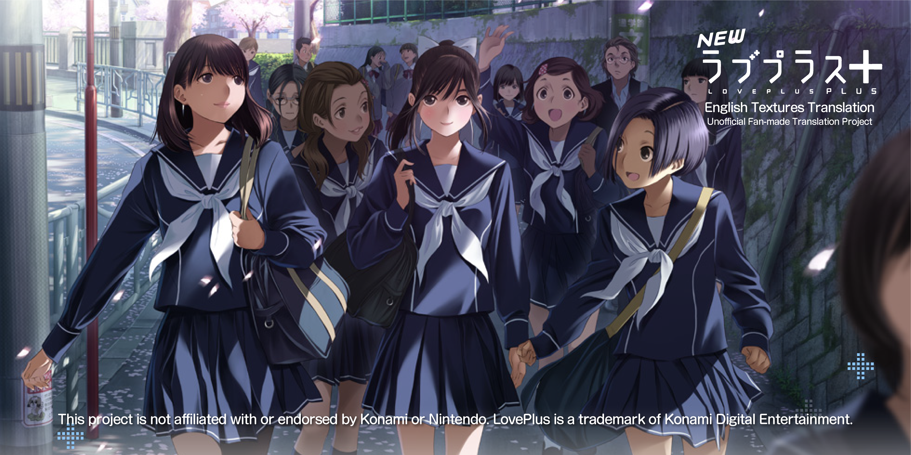
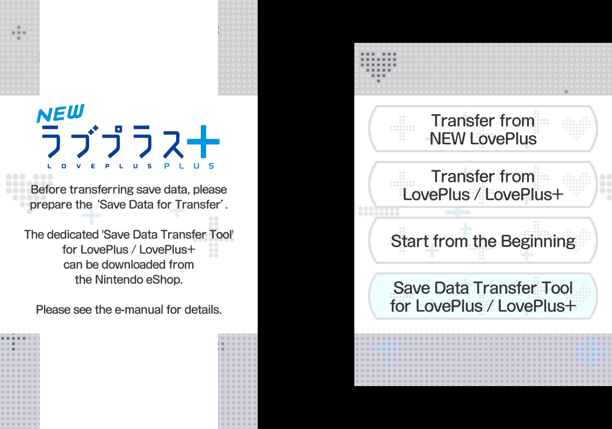
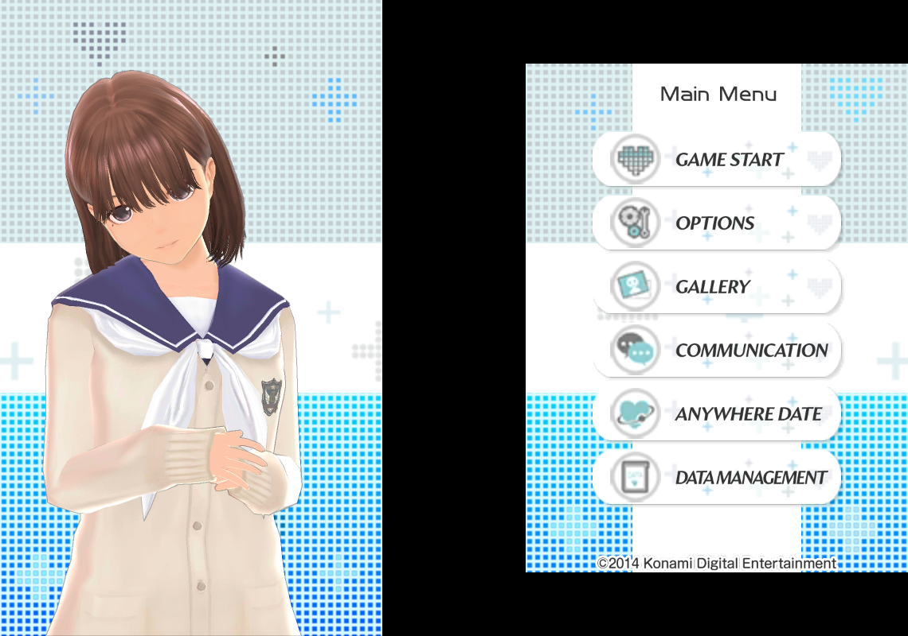
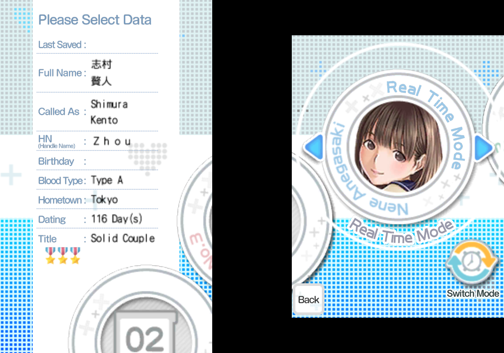
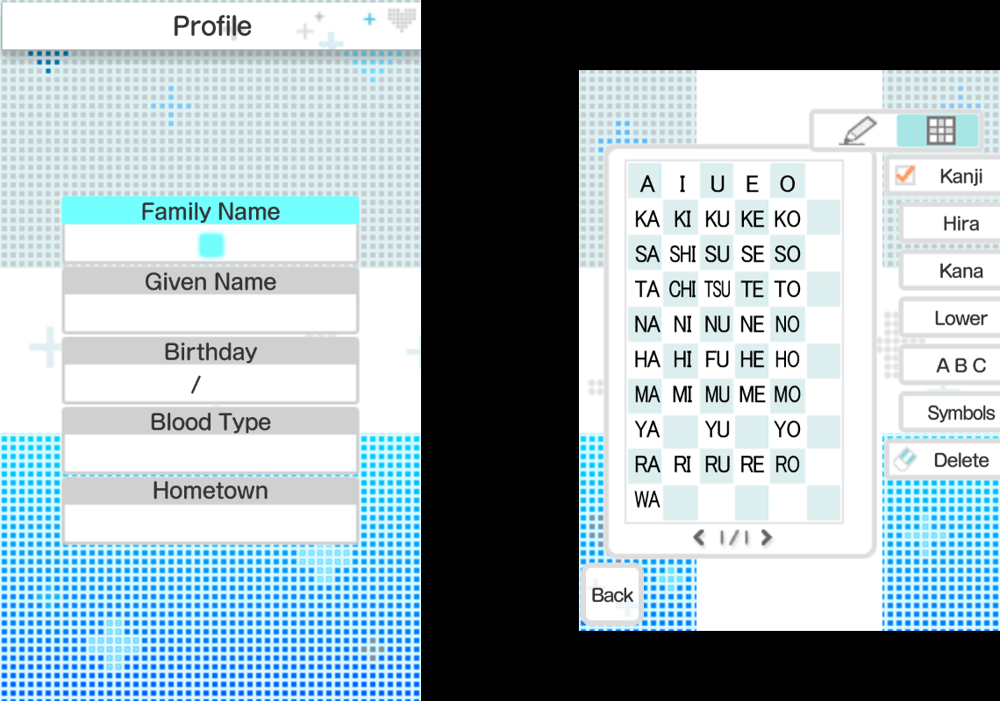
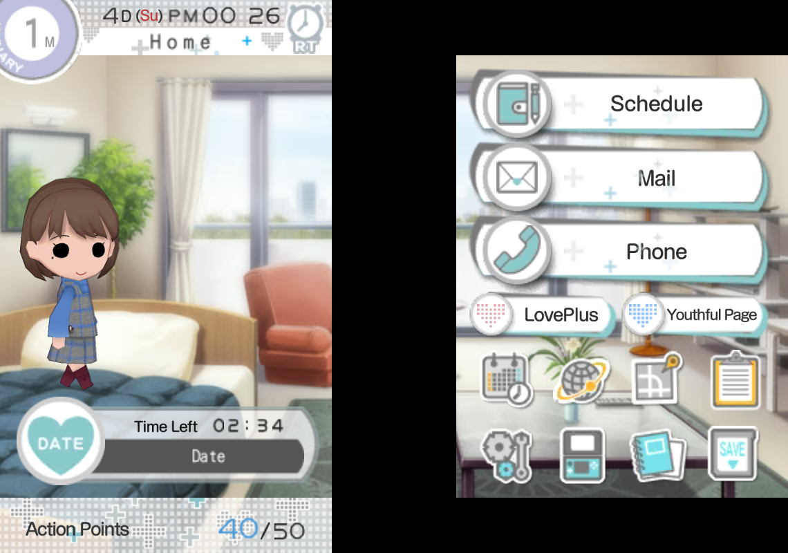
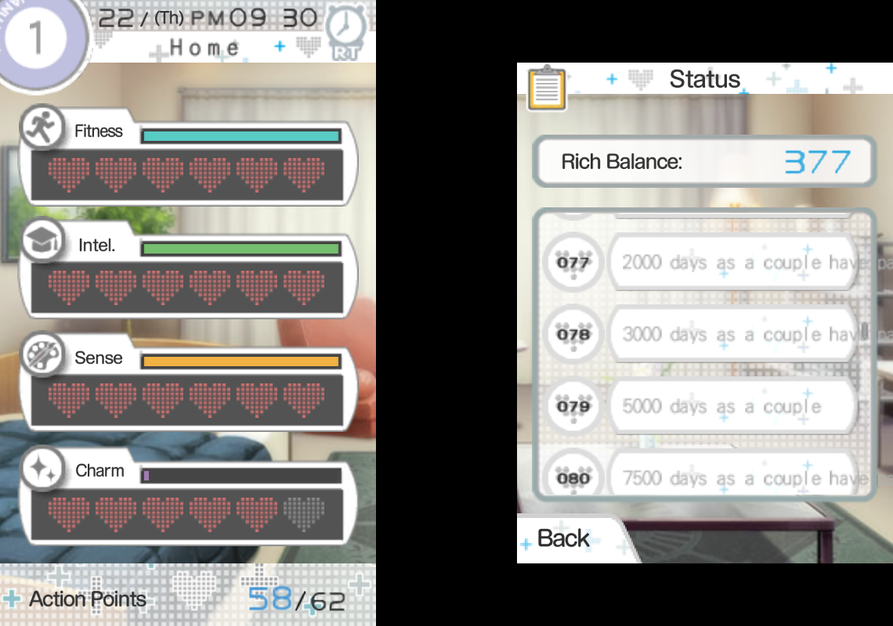

# NLPP-ETT (NEW LovePlus+ English Textures Translation)

A reworked English UI textures translation and custom textures for **NEW LovePlus+** on Citra / Azahar.

  

## About The Project

This repository contains the English translated UI and custom textures for *NEW LovePlus+*. Originally starting as a project to edit the game's ROM directly, it has evolved into a Custom Texture pack designed specifically for the Citra and Azahar emulators. 

This project aims to provide a high-quality visual translation for menus, UI elements, and various in-game graphics, carefully matching the original game's fonts and style.

## The Story So Far

I started this project on May 14, 2025, because I wanted to improve the translation quality and progress of the existing community project. 

I unpacked every game file—from `img.bin`, `.arc`, `.bclim`, all the way down to the `.png` files—and organized everything. I extracted the Japanese text, translated it, found matching fonts, and edited every texture one by one. By June 1, 2025, the translation was about 70-75% complete (covering around 1,694 files). 

However, things didn't go as planned when I tried to repack them. I discovered a harsh limitation: the size of the data inside `img.bin` cannot change because it breaks the file offsets. My translated files were slightly larger, which caused textures to disappear or turn into black squares in-game. Compressing them made them incredibly blurry. Feeling hopeless after months of work, I took a break.

I knew about emulator Custom Textures, but realizing that the dumped PNG filenames and resolutions were completely different from the original `.bclim` files meant I essentially had to redo 70% of my work. 

Finally, on November 5, 2025, I regained my motivation. I dumped the textures, identified each one, matched them to their original folders, and replaced them with my translated versions. Seeing the results working flawlessly in-game made it all worth it!

## In-Game Preview

<table border="0">
  <tr>
    <td>
      
      
<b>Transfer Save Data</b>

    </td>
    <td>
      
      
<b>Main Menu</b>

    </td>
  </tr>
  <tr>
    <td>
      
      
<b>Select Save Data</b>

    </td>
    <td>
      
      
<b>Profile Creation</b>

    </td>
  </tr>
    <tr>
    <td>
      
      
<b>My Room</b>

    </td>
    <td>
      
      
<b>My Status</b>

    </td>
  </tr>
</table>

## Texture Usage Guide

### 1. `Translated_PNG [EN]` (Raw Assets)
* **Target Audience:** Modders and advanced users.
* **Technical Requirement:** These raw translated PNGs **cannot** be repacked directly into BCLIM archives or `img.bin` as-is. Due to strict offset constraints in the game engine, the exact file byte size of each translated PNG must strictly match the byte size of the original Japanese PNG.
* **Recommended Patcher:** If you want an easy, automated solution to apply these UI texture translations directly to your dumped 3DS game files, use [NewLovePlusPlusEngPatcher by zaccken](https://github.com/zaccken/NewLovePlusPlusEngPatcher).

---

### 2. `Custom Textures` for Citra / Azahar *(Coming Soon!)*
Custom textures load dynamically via the emulator without modifying your game ROM.

* **Resolution Variants:**
  * `1x_Resolution` *(Native)*: Ideal for low-end devices or small screens.
  * `2x_Resolution`: Optimal for mid-range devices and modern handhelds.
  * `3x_Resolution`: Recommended for mid-to-high-end PCs and large displays.

* **Installation Steps:**
  1. Extract the chosen resolution folder into your emulator's texture directory:  
     `Citra (or Azahar) ➔ load ➔ textures`
  2. Open emulator settings and navigate to **Graphics**.
  3. Enable **Use custom textures**.
  4. *(Optional)* Enable **Preload custom textures** for smoother stutter-free performance (recommended for higher-spec devices).

* **⚠️ Important Notes:**
  * **Vanilla ROM Required:** Your 3DS ROM (ARC / TEXI archives) must remain unpatched/vanilla, as custom textures rely on the original file hashes to load properly.
  * **Mod Conflicts:** If you are using RomFS mods, make sure there is **no `img.bin`** inside your mod folder. A `img.bin` alters texture hashes, causing custom textures to fail to load.

---

## Troubleshooting

If the game **freezes or crashes** upon launching (especially with *Preload custom textures* enabled):

1. **Clear Shader Cache:** Delete the **Disk Shader Cache** for NEW LovePlus+ in Citra/Azahar.
2. **Disable Preloading:** Turn off **Preload custom textures** and use standard custom texture loading instead.
3. **Lower Texture Resolution:** If your device runs out of RAM/VRAM, switch to a lower resolution pack (e.g., from `3x` to `2x` or `1x`).
4. **Switch Graphics Renderer:** Change your emulator's graphics API from **OpenGL** to **Vulkan** for better memory stability.

## Translation Progress

**Last Updated:** October 19, 2026

Below is the texture translation progress breakdown per ARC or Package folder in the game.

| ARC / Package Folder Name | Progress (Translated / Total) | Status |
| :--- | :---: | :--- |
| `0002_data` | 1 / 1 | ✅ Complete |
| `0003_data` | 1 / 1 | ✅ Complete |
| `0007_data` | 26 / 26 | ✅ Complete |
| `0090_data` | 3 / 3 | ✅ Complete |
| `4090_data` | 0 / 8 | ❌ Not Started |
| `4091_data` | 0 / 12 | ❌ Not Started |
| `5359_data` | 0 / 1 | ❌ Not Started |
| `5362_data` | 0 / 27 | ❌ Not Started |
| `5366_data` | 0 / 1 | ❌ Not Started |
| `5369_data` | 0 / 2 | ❌ Not Started |
| `5398_data` | 0 / 9 | ❌ Not Started |
| `5440_data` | 0 / 2 | ❌ Not Started |
| `5754_data` | 0 / 1 | ❌ Not Started |
| `5779_data` | 0 / 3 | ❌ Not Started |
| `5780_data` | 0 / 3 | ❌ Not Started |
| `5781_data` | 0 / 3 | ❌ Not Started |
| `5789_data` | 0 / 27 | ❌ Not Started |
| `5792_data` | 0 / 1 | ❌ Not Started |
| `Album (4149_data)` | 39 / 39 | ✅ Complete |
| `AMScratch (4150_data)` | 7 / 7 | ✅ Complete |
| `CameraSetting (4151_data)` | 12 / 12 | ✅ Complete |
| `Camera_Btn00 (5322_data)` | 4 / 4 | ✅ Complete |
| `Camera_Btn01 (5323_data)` | 2 / 2 | ✅ Complete |
| `Camera_Btn02_c (5324_data)` | 20 / 20 | ✅ Complete |
| `Camera_Btn02_l (5324_data)` | 20 / 20 | ✅ Complete |
| `Camera_Btn02_r (5324_data)` | 20 / 20 | ✅ Complete |
| `Camera_Btn03 (5325_data)` | 19 / 19 | ✅ Complete |
| `Camera_Btn04 (5326_data)` | 3 / 3 | ✅ Complete |
| `Camera_Pv03 (5351_data)` | 1 / 1 | ✅ Complete |
| `Card (4152_data)` | 22 / 22 | ✅ Complete |
| `ClockInfo (5402_data)` | 28 / 28 | ✅ Complete |
| `CmdJudge (4182_data)` | 6 / 6 | ✅ Complete |
| `Common02Icon (4184_data)` | 16 / 16 | ✅ Complete |
| `Commu_Option (4185_data)` | 4 / 4 | ✅ Complete |
| `Contest (4186_data)` | 16 / 16 | ✅ Complete |
| `CTRWare (5381_data)` | 12 / 12 | ✅ Complete |
| `DataDelete (4187_data)` | 6 / 6 | ✅ Complete |
| `DataExport (4188_data)` | 8 / 8 | ✅ Complete |
| `DataImport (4189_data)` | 1 / 1 | ✅ Complete |
| `DateEdit (5382_data)` | 114 / 114 | ✅ Complete |
| `DateEdit01 (4190_data)` | 5 / 5 | ✅ Complete |
| `DateEdit02 (4191_data)` | 13 / 13 | ✅ Complete |
| `DateEdit03 (4192_data)` | 10 / 10 | ✅ Complete |
| `DateEdit04 (4193_data)` | 15 / 15 | ✅ Complete |
| `DateEdit05 (4194_data)` | 12 / 12 | ✅ Complete |
| `DateEditAlbum (5383_data)` | 17 / 17 | ✅ Complete |
| `DateEditBase01 (4195_data)` | 37 / 37 | ✅ Complete |
| `DateEditBase02 (4196_data)` | 49 / 49 | ✅ Complete |
| `DateEditBase03 (4197_data)` | 21 / 21 | ✅ Complete |
| `DateEditCamera (5384_data)` | 94 / 94 | ✅ Complete |
| `DateEditCom (4198_data)` | 55 / 55 | ✅ Complete |
| `DateEditMain (5385_data)` | 94 / 94 | ✅ Complete |
| `DateEditMaskEdit (4199_data)` | 9 / 9 | ✅ Complete |
| `DateEditSpotInfo (5386_data)` | 94 / 94 | ✅ Complete |
| `DLC (4200_data)` | 2 / 2 | ✅ Complete |
| `ExCardCommon` | 0 / 78 | ❌ Not Started |
| `ExCardManaka` | 0 / 15 | ❌ Not Started |
| `ExCardNene` | 0 / 15 | ❌ Not Started |
| `ExCardRinko` | 0 / 16 | ❌ Not Started |
| `FileSelect (5152_data)` | 10 / 10 | ✅ Complete |
| `Gallery (5394_data)` | 7 / 7 | ✅ Complete |
| `Gallery_Common (5153_data)` | 19 / 19 | ✅ Complete |
| `GameInfo (5188_data)` | 7 / 7 | ✅ Complete |
| `GirlsTalk (5189_data)` | 3 / 3 | ✅ Complete |
| `HairCatalog (5395_data)` | 17 / 17 | ✅ Complete |
| `HV_BG (0019_data)` | 2 / 2 | ✅ Complete |
| `InputCTexture (5190_data)` | 9 / 9 | ✅ Complete |
| `InputNTexture (5190_data)` | 9 / 9 | ✅ Complete |
| `Intro108 (5191_data)` | 1 / 1 | ✅ Complete |
| `Intro201 (5193_data)` | 7 / 7 | ✅ Complete |
| `Intro301 (5195_data)` | 1 / 1 | ✅ Complete |
| `IntroCommon (5197_data)` | 19 / 19 | ✅ Complete |
| `Item (5198_data)` | 10 / 10 | ✅ Complete |
| `ItemSelect (5199_data)` | 5 / 5 | ✅ Complete |
| `KareshiPower (5501_data)` | 4 / 4 | ✅ Complete |
| `LocalMatching (5200_data)` | 3 / 3 | ✅ Complete |
| `LoveLink (5201_data)` | 12 / 12 | ✅ Complete |
| `LovePlusMode (5202_data)` | 8 / 8 | ✅ Complete |
| `LPM_Info (5205_data)` | 7 / 7 | ✅ Complete |
| `Mail (5207_data)` | 63 / 63 | ✅ Complete |
| `map_layout (4074_data)` | 30 / 30 | ✅ Complete |
| `MeetingDate (5209_data)` | 6 / 6 | ✅ Complete |
| `MeetingTime (5210_data)` | 8 / 8 | ✅ Complete |
| `Myroom (5380_data)` | 34 / 34 | ✅ Complete |
| `MyroomHeader (5575_data)` | 21 / 21 | ✅ Complete |
| `NCommon (5237_data)` | 41 / 41 | ✅ Complete |
| `NCommonIcon (5238_data)` | 36 / 36 | ✅ Complete |
| `NCommonMSel (5239_data)` | 5 / 5 | ✅ Complete |
| `NCommonMSel (5240_data)` | 25 / 25 | ✅ Complete |
| `NCommonMSel (5241_data)` | 30 / 30 | ✅ Complete |
| `NCommonMSel (5242_data)` | 17 / 17 | ✅ Complete |
| `NCommonMSel (5243_data)` | 1 / 1 | ✅ Complete |
| `NCommonMSel (5244_data)` | 20 / 20 | ✅ Complete |
| `NCommonMSel (5245_data)` | 19 / 19 | ✅ Complete |
| `NCommonMSel (5246_data)` | 1 / 1 | ✅ Complete |
| `Option (5247_data)` | 10 / 10 | ✅ Complete |
| `Option06 (5248_data)` | 10 / 10 | ✅ Complete |
| `OptionClock (5249_data)` | 8 / 8 | ✅ Complete |
| `OptionLock (5250_data)` | 4 / 4 | ✅ Complete |
| `OptionPassword (5251_data)` | 1 / 1 | ✅ Complete |
| `Profile (5252_data)` | 27 / 27 | ✅ Complete |
| `Quest (5253_data)` | 17 / 17 | ✅ Complete |
| `ScdKareshi (5254_data)` | 11 / 11 | ✅ Complete |
| `ScdStatus (5255_data)` | 7 / 7 | ✅ Complete |
| `Schedule (5256_data)` | 18 / 18 | ✅ Complete |
| `ScheduleF (5257_data)` | 6 / 6 | ✅ Complete |
| `Shop (5258_data)` | 17 / 17 | ✅ Complete |
| `SysPopup (5259_data)` | 33 / 33 | ✅ Complete |
| `Telephone (5260_data)` | 25 / 25 | ✅ Complete |
| `Title (5261_data)` | 8 / 8 | ✅ Complete |
| `TownGuide (5265_data)` | 11 / 31 | ⏳ Partial |
| `TownVoice (5266_data)` | 5 / 5 | ✅ Complete |
| `Transfer (5564_data)` | 28 / 28 | ✅ Complete |
| `TutorialImg` | 0 / 11 | ❌ Not Started |
| `Web (5316_data)` | 20 / 20 | ✅ Complete |

> **Note:** "⏳ Partial" means that the folder is only partially translated. Some textures within these archives still remain in Japanese.

**Current Status: Still and Continuously Updating!** 

While it was briefly on hold due to real-life work and needing game progress to trigger new textures (for Custom Textures), the project is now back in active development.

## Texture Quality & Reuse Policy

* All translated textures (including 1x, 2x, and 3x custom resolution packs) were manually edited and several were completely redrawn by hand. **No AI upscaling or automated image generation tools** were used for any of the visual assets.
* AI was strictly used as a supplementary tool for translating Japanese text into English.
* Fellow modders and community members are welcome to use or build upon these assets in their own projects or patches. However, as a tremendous amount of time and effort went into manually recreating these textures, **please kindly provide proper credit and link back to this repository** if you use them.

## Credits & Acknowledgements

* **Tools:** [NLPP Tools by kiwiz](https://github.com/kiwiz/nlpp-tools), [NLPP Texture Tool by czyrustuazon](https://github.com/czyrustuazon/nlpp-texture-tool), and NLPP Toolchain by [Cetaceaqua](https://github.com/Cetaceaqua)
* **Work Reference:** [Makein's NLPPGit](https://github.com/Makein/NLPPGit)
* **Patcher / Integration:** [NewLovePlusPlusEngPatcher by czyrustuazon](https://github.com/czyrustuazon/NewLovePlusPlusEngPatcher)

## Disclaimer / Legal Notice

*This is a **non-profit, fan-made translation and modification project**. `NLPP-ETT` (NEW LovePlus+ English Textures Translation) is entirely unofficial and is **not** affiliated with, endorsed, sponsored, or approved by **Konami Digital Entertainment**, the original developers, or any of their associated partners. All rights, copyrights, and the ラブプラス (LovePlus) trademarks belong exclusively to Konami Digital Entertainment. Please support the creators by purchasing the official releases.*

---
*If you find any textures that need fixing or revision, feel free to let me know on Discord [Project NLP+ Localization](https://discord.gg/ctbnsPC3jn)!*
